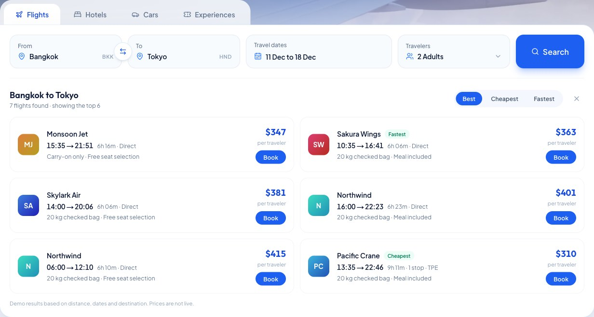
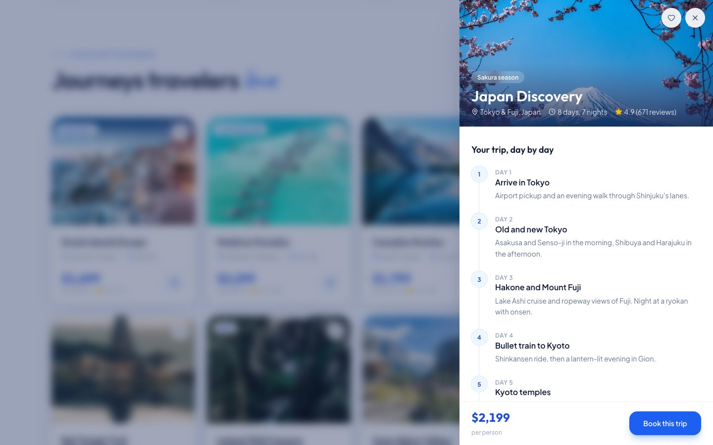
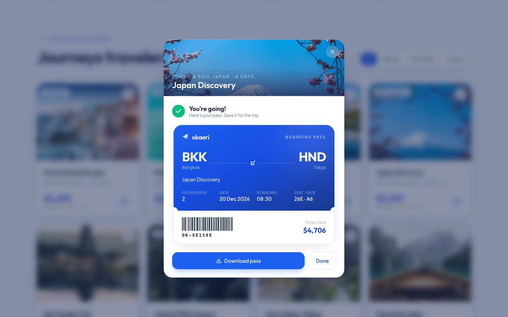
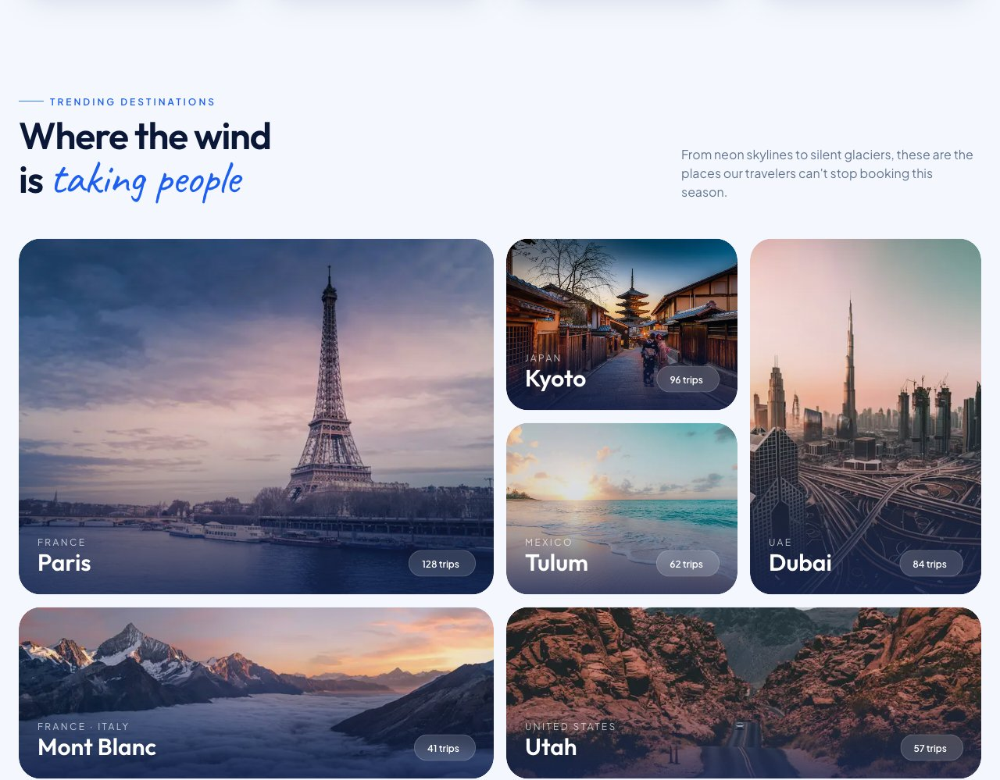

# Okaeri

### A travel booking site you can actually click through, from search to boarding pass.

Okaeri (おかえり) is what you hear when you come home in Japan: "welcome back". This is a demo travel site built around that idea. You can search flights, hotels, cars and experiences, open a package to read the trip day by day, save the ones you like and book one to get a boarding pass at the end. Nothing is charged and no data leaves the browser; every price is generated so the site works with no backend.


| Search results | Package details | Boarding pass |
| --- | --- | --- |
|  |  |  |

## Features

- A paper plane, drawn from the same shape as the logo, flies in along a dashed trail and drifts with the scroll.
- Search on four tabs: Flights, Hotels, Cars and Experiences. Cities autocomplete as you type, dates are picked as a range in one calendar, and the travelers list opens below the field.
- Results appear right under the search, sortable by best, cheapest and fastest (or top rated). Each one can be booked straight away.
- Package cards filter by Beach, Mountain and Culture, and swipe sideways on phones. Tapping a card opens a side panel with the day-by-day plan and what's included.
- Booking ends with a boarding pass: route, seat, gate, a barcode and the booking reference. It downloads as a PNG.
- A wishlist with a counter in the navbar, and a USD / THB switch where every price counts up to the new amount. Both are remembered between visits.
- Destination cards search flights from Bangkok to that city.
- Pricing plans with a couple-pricing toggle.
- A favicon and a share image for LINE, Facebook and X, both generated in code.



## Stack

Next.js 16 (App Router, Turbopack, Cache Components), React 19, TypeScript, Tailwind CSS v4 and Motion for the animation. Icons from Lucide, `html-to-image` for the boarding pass download. Photos come from Unsplash.

## Running it

Needs Node 20.9+ and pnpm.

```bash
pnpm install
pnpm dev
```

`pnpm build && pnpm start` for a production build, `pnpm lint` to lint.

There's nothing to configure for local use. One optional variable:

| Variable | What it's for |
| --- | --- |
| `NEXT_PUBLIC_SITE_URL` | Optional. The absolute URL used for share images. On Vercel the production URL is picked up automatically; elsewhere it falls back to `http://localhost:3000`. |

## Notes

The search results are made up, but not random. `src/lib/deals.ts` seeds its generator with the search itself, so the same search always shows the same deals. Flight prices and times come from the great-circle distance between the two cities, hotel and car prices from the number of nights and how expensive the city is. Airline, hotel and rental company names are fictional, and the results say so.

The currency and the wishlist live in `localStorage` behind `useSyncExternalStore`. The server always renders the defaults (USD, empty wishlist) and the browser switches to the saved values right after hydration, so there's no mismatch. Prices are stored in USD and converted only when shown. Baht prices are rounded the way Thai travel sites show them (฿72,567 becomes ฿72,500), and the booking breakdown is worked out from those rounded prices so the lines always add up to the total.

Sections talk to the hero search through a small event bus (`src/lib/search-bus.ts`). A destination card or a footer link sends a request, and the search panel fills in the form, runs it and scrolls itself into view.

The date picker is custom. It reads "today" only when the calendar opens, because Next.js 16 with Cache Components flags `new Date()` during prerendering. Popovers catch Escape on `window` before anything else, so closing a calendar inside the booking modal doesn't close the modal too.

Overlays share one counted scroll lock. Going from the package panel straight into the booking modal keeps the page locked while one closes and the other opens.

## Where things are

- `src/app/`: the page, layout, `icon.svg`, `apple-icon.tsx` and `opengraph-image.tsx`
- `src/components/`: one file per section (`hero`, `search-panel`, `packages`, `destinations`, `pricing`, `how-to-book`, `stories`, `cta-footer`) plus the pieces they share: `booking` (the modal), `boarding-pass`, `package-drawer`, `date-picker`, `fields` (city autocomplete and dropdown), `popover`, `prefs` (currency and wishlist) and `paper-plane` (the plane and the logo)
- `src/lib/data.ts`: packages, destinations, pricing plans and testimonials
- `src/lib/places.ts`: the cities you can search, with airport codes and coordinates
- `src/lib/itineraries.ts`: the day-by-day plan and inclusions for each package
- `src/lib/deals.ts`: the search result generator
- `src/lib/search-bus.ts`: the event that lets other sections run a search

Content changes don't need a component change. To add a package, add an entry to `PACKAGES` in `src/lib/data.ts` with a `placeId` from `src/lib/places.ts`, and its days to `ITINERARIES` in `src/lib/itineraries.ts`. To make a city searchable, add it to `PLACES`.

## License

© 2026 Okaeri by windyoncloud. All rights reserved.
